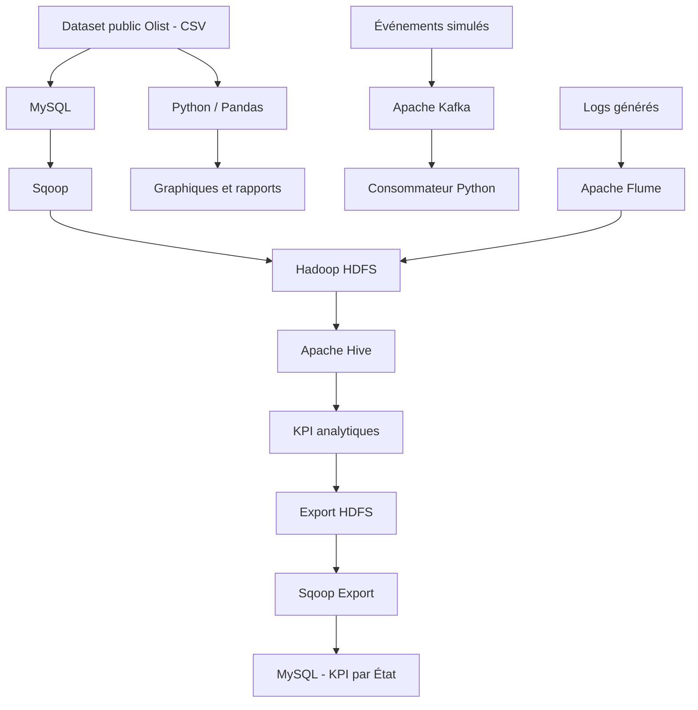

# Big Data E-commerce Analytics — Olist

## 1. Présentation du projet

Ce projet met en œuvre une architecture Big Data appliquée à l’analyse des données d’une plateforme e-commerce. Il s’appuie sur le **Brazilian E-Commerce Public Dataset by Olist**, un jeu de données public décrivant des commandes, des clients, des vendeurs, des produits, des paiements et des avis clients.

L’objectif est de mettre en place une chaîne de traitement de données combinant ingestion, stockage distribué, traitement analytique et restitution d’indicateurs métier.

### Objectifs

- Importer des données relationnelles dans Hadoop HDFS avec Sqoop.
- Simuler un flux d’événements de commandes avec Apache Kafka.
- Collecter des logs applicatifs avec Apache Flume.
- Exécuter des requêtes analytiques avec Apache Hive.
- Stocker et exporter des résultats analytiques vers MySQL.
- Calculer et visualiser des KPI avec Python.
- Conteneuriser l’environnement technique avec Docker Compose.

> **Important :** le dataset Olist est historique. Le flux Kafka est simulé à partir des données disponibles et les logs Flume sont générés pour les besoins de la démonstration. Il ne s’agit pas d’une collecte de transactions e-commerce en production.

## 2. Technologies utilisées

| Technologie | Rôle |
|---|---|
| Docker Compose | Déploiement des services |
| Apache Hadoop HDFS | Stockage distribué |
| Apache Kafka | Simulation d’un flux d’événements |
| Apache Sqoop | Transfert entre MySQL et HDFS |
| Apache Flume | Collecte de logs |
| Apache Hive | Requêtes analytiques sur les données |
| MySQL | Base relationnelle et stockage des KPI exportés |
| Python, Pandas, Matplotlib | Analyse et visualisation |
| PowerShell | Exécution des commandes sous Windows |

## 3. Architecture générale



## 4. Prérequis

Avant de démarrer, installer :

- Docker Desktop avec Docker Compose.
- Git.
- Python 3.11 ou une version compatible avec les dépendances du projet.
- Visual Studio Code, recommandé pour consulter les scripts et les configurations.

Vérifier les installations :

```powershell
docker --version
docker compose version
git --version
python --version
```

Vérifier que Docker Desktop est démarré :

```powershell
docker info
```

## 5. Installation du projet

Cloner le dépôt GitHub :

```powershell
git clone <URL_DU_DEPOT_GITHUB>
cd bigdata-olist
```

Si le dépôt est déjà présent localement, se placer directement dans son dossier.

Vérifier les fichiers :

```powershell
Get-ChildItem
```

## 6. Démarrage de l'environnement Docker

Construire les images et démarrer les services principaux :

```powershell
docker compose up -d --build
```

Démarrer également les services déclarés sous le profil Hive :

```powershell
docker compose --profile hive up -d --build
```

Vérifier les conteneurs :

```powershell
docker ps
```

Consulter les logs d'un service si nécessaire :

```powershell
docker logs olist-mysql
docker logs namenode
docker logs kafka
```

Les noms des conteneurs peuvent varier selon la configuration Docker Compose.

## 7. Import des données avec Sqoop

Le script d'import transfère les tables relationnelles de MySQL vers HDFS.

```powershell
docker exec -it olist-tools bash /project/sqoop/import_all.sh
```

Vérifier les données importées :

```powershell
docker exec namenode hdfs dfs -ls /data/olist/sqoop
```

Cette étape permet de vérifier la présence des répertoires correspondant aux tables importées.

## 8. Streaming simulé avec Kafka

Le projet utilise Kafka pour illustrer la transmission et la consommation d'événements de commandes.

Lancer le producteur :

```powershell
python .\scripts\kafka_producer.py --rate 10 --limit 300
```

Lancer le consommateur dans un autre terminal PowerShell :

```powershell
python .\scripts\kafka_consumer.py --max 500
```

Le consommateur traite les événements reçus et affiche des statistiques par État.

Le broker Kafka est configuré pour être accessible depuis l'hôte via `localhost:29092` dans la configuration utilisée pour la démonstration. Les paramètres du producteur et du consommateur doivent correspondre à cette configuration.

## 9. Collecte des logs avec Flume

Générer des fichiers de logs de démonstration :

```powershell
python .\scripts\generate_logs.py --files 3 --lines 2000
```

Lancer l'agent Flume :

```powershell
docker exec -it olist-tools flume-ng agent -n a1 -c /opt/flume/conf -f /project/flume/weblog.conf -Dflume.root.logger=INFO,console
```

Une fois la collecte terminée, arrêter l'agent si nécessaire avec `Ctrl + C`.

Vérifier les fichiers stockés dans HDFS :

```powershell
docker exec namenode hdfs dfs -ls -R /data/olist/logs
```

Les logs permettent d'illustrer une chaîne de collecte de données applicatives.

## 10. Analyse avec Hive

Exécuter le script analytique :

```powershell
docker exec -it olist-tools hive -f /project/hive/02_kpis.hql
```

Le script calcule notamment :

1. Le chiffre d'affaires et le nombre de commandes par mois.
2. Les principales catégories de produits par chiffre d'affaires.
3. La répartition des moyens de paiement.
4. Le délai moyen de livraison et la note moyenne par État.
5. La répartition des événements de navigation collectés par Flume.

Il exporte également des KPI agrégés par État vers HDFS :

```text
/data/olist/export/kpi_state
```

Les résultats dépendent des filtres, des jointures et des règles de calcul définis dans les requêtes Hive.

## 11. Export des KPI vers MySQL

Exécuter le script Sqoop d'export :

```powershell
docker exec -it olist-tools bash /project/sqoop/export_kpi.sh
```

Vérifier les données dans MySQL :

```powershell
docker exec olist-mysql mysql -uroot -proot123 -e "SELECT customer_state, nb_orders, revenue, avg_ticket FROM olist.kpi_sales_by_state ORDER BY revenue DESC LIMIT 5;"
```

Cette étape illustre le transfert des résultats analytiques de HDFS vers une table relationnelle exploitable par d'autres applications.

**Sécurité :** les identifiants ci-dessus correspondent à l'environnement de démonstration décrit dans ce projet. Ne jamais réutiliser ces identifiants en production.

## 12. Analyse Python et visualisation

Exécuter le script d'analyse :

```powershell
python .\scripts\analysis_kpis.py
```

Lister les résultats générés :

```powershell
Get-ChildItem .\output
```

Le dossier `output` peut contenir des fichiers CSV et des graphiques relatifs à l'analyse du chiffre d'affaires, des paiements, des catégories de produits, de la livraison et de la satisfaction client.

## 13. Captures d'écran et preuves d'exécution

Les captures de démonstration sont regroupées dans :

```text
docs/captures/
```

Elles peuvent présenter :

- Les conteneurs Docker actifs.
- Les répertoires de données dans HDFS.
- Les résultats du producteur et du consommateur Kafka.
- L'import et l'export Sqoop.
- La collecte des logs par Flume.
- Les résultats des requêtes Hive.
- Les KPI et les visualisations Python.

## 14. Structure du dépôt

```text
bigdata-olist/
├── data/
│   ├── raw/
│   └── logs/
├── docs/
│   └── captures/
├── flume/
├── hive/
├── scripts/
├── sqoop/
├── tools/
├── output/
├── docker-compose.yml
├── .gitignore
└── README.md
```


## 15. Limites et précautions d'interprétation

- Les données Olist sont historiques et ne constituent pas un flux temps réel.
- Les événements Kafka sont simulés pour la démonstration.
- Les logs Flume sont générés artificiellement.
- Les KPI dépendent des requêtes, des jointures et des filtres appliqués.
- Les résultats ne doivent pas être interprétés comme des mesures d'une plateforme en production.
- Les identifiants de démonstration ne doivent pas être utilisés dans un environnement réel.

## 16. Auteurs et contexte académique

**Projet académique Big Data — E-commerce Olist**

Réalisé dans le cadre du cycle ingénieur Data Science.


## 17. Licence et attribution des données

Les données proviennent du Brazilian E-Commerce Public Dataset by Olist. Avant toute redistribution du dataset brut, vérifier les conditions de licence et les règles de redistribution applicables à la source originale.

